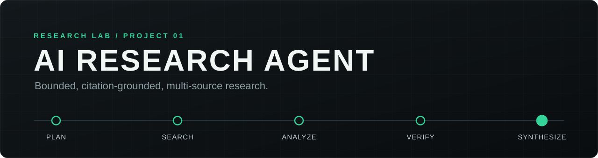
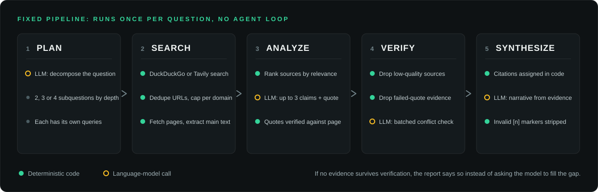
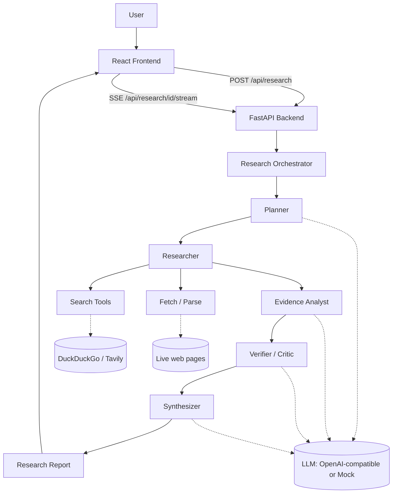

<div align="center">



<br />

**A bounded, citation-grounded multi-source research agent.**
Ask a question. It plans, searches the live web, reads the sources, checks the evidence and writes a report where every citation points at a page it actually retrieved.

<br />


[Overview](#overview) · [Pipeline](#pipeline) · [Grounding](#citation-grounding) · [Quick start](#quick-start) · [Configuration](#configuration) · [API](#api) · [Evaluation](#evaluation) · [Limitations](#limitations)

</div>

<br />

## Overview

Ask something like *"Compare current approaches for reducing hallucinations in large language models"* and the system runs a fixed, explainable pipeline, not an open-ended agent loop. The result is a report with an executive summary, key findings, evidence, explicitly surfaced conflicts, uncertainty, and numbered citations to the sources actually retrieved.

Most "AI research" demos are a single LLM call with a nice UI: the model free-associates an answer and citations that may or may not exist. This project is built around the opposite failure mode, "looks authoritative, isn't grounded":

- **Bounded.** Hard caps on subquestions, queries, sources and concurrency keep a run predictable and cheap.
- **Traceable.** Every claim links back to a real, retrieved source.
- **Honest about disagreement.** Conflicts between sources are surfaced, not averaged away.
- **Honest about gaps.** If no evidence survives verification, the report says so.

It is project #1 of a five-project AI/GenAI engineering portfolio, built to show the parts of applied LLM engineering that a wrapper-around-an-API demo skips: structured tool-calling pipelines, retrieval and source evaluation, citation grounding, conflict detection, cost-aware prompting and a reproducible evaluation harness.

### Highlights

<table>
  <tr>
    <td width="33%" valign="top">
      <h4>Code-assigned citations</h4>
      Markers are assigned in code from retrieved sources, then re-validated after synthesis. Any <code>[n]</code> the model invents is stripped.
    </td>
    <td width="33%" valign="top">
      <h4>Verified quotes</h4>
      Every extracted quote is checked against the page text with a normalised substring match. Failed quotes are dropped before synthesis.
    </td>
    <td width="33%" valign="top">
      <h4>Conflicts surfaced</h4>
      Disagreement between sources becomes its own "Conflicting Evidence" section instead of being merged into one narrative.
    </td>
  </tr>
  <tr>
    <td valign="top">
      <h4>Cost-aware</h4>
      Deterministic filtering runs before every LLM call, the verifier is a single batched call, and usage and estimated cost are reported per run.
    </td>
    <td valign="top">
      <h4>Runs with no keys</h4>
      A mock LLM and mock search make demos, tests and CI free. Real search alone gives a retrieval-backed run at zero LLM cost.
    </td>
    <td valign="top">
      <h4>Live progress</h4>
      Stages stream to the UI over Server-Sent Events: Planning, Searching, Analyzing, Verifying, Synthesizing.
    </td>
  </tr>
</table>

## Pipeline

<p align="center">
  
</p>

Each stage is a plain async function with explicit Pydantic input and output types ([`backend/app/models/schemas.py`](backend/app/models/schemas.py)), sequenced only by the [orchestrator](backend/app/agent/orchestrator.py). State passed between stages is structured data, not free-form text, and the pipeline always runs Plan, Search, Analyze, Verify, Synthesize exactly once.

| Stage | Module | What it does |
| --- | --- | --- |
| **Plan** | [`planner.py`](backend/app/agent/planner.py) | One LLM call decomposes the question into 2 / 3 / 4 subquestions for `quick` / `standard` / `deep`, each carrying its own `search_queries` (`SubquestionPlan`), an explicit relationship rather than two lists matched by position. |
| **Search** | [`researcher.py`](backend/app/agent/researcher.py) | No LLM. Runs each query against the search provider, dedupes by URL, caps sources per domain for diversity, fetches pages concurrently (bounded semaphore, timeouts, retries) and extracts main text with BeautifulSoup. Tracks cache hits and per-query search success. |
| **Analyze** | [`evidence.py`](backend/app/agent/evidence.py) | Ranks fetched sources by lexical relevance to their subquestion and keeps the top N. One bounded LLM call *per kept source* extracts at most 3 claims, each with a verbatim quote. Context is chosen by paragraph-relevance scoring, and each quote is checked against the full page text, so `Evidence.quote_verified` is set by code, never by the model. |
| **Verify** | [`verifier.py`](backend/app/agent/verifier.py) | Drops evidence from sources below a quality floor and evidence whose quote failed verification, then makes a **single batched** LLM call over the remaining claims to flag cross-source conflicts and unsupported claims. |
| **Synthesize** | [`synthesizer.py`](backend/app/agent/synthesizer.py) | Assigns citation markers in code, builds the Evidence section directly from verified claims, and makes one final LLM call, grounded only in surviving evidence, for the narrative sections. The output is then swept for invalid markers. With no surviving evidence it returns an explicit "insufficient evidence" report. |

### System architecture



### The report

A `ResearchReport` contains: `executive_summary`, `methodology`, `key_findings`, `evidence_summary`, `conflicting_evidence`, `analysis`, `uncertainty`, `conclusion`, the `sources` with full provenance (title, URL, domain, source type, retrieval timestamp, and the query that surfaced each), `citations`, an `insufficient_evidence` flag and `quality_stats`. Each job also carries `UsageStats`: searches, cache hits, sources, LLM calls, tokens, estimated cost and duration.

## Citation grounding

Citation IDs are **assigned and validated deterministically against retrieved sources**, never trusted to the LLM.

1. The synthesizer assigns `[1]`, `[2]`, … in code, in order of first evidence use, only to sources that actually produced surviving evidence. The model is told which marker maps to which evidence and asked to reuse it, never to invent one.
2. **After** synthesis, every free-text field the model wrote (executive summary, key findings, analysis, conclusion) is scanned for `[n]` markers by [`citation_validator.py`](backend/app/services/citation_validator.py). Any marker that doesn't match an assigned source is removed, not replaced with a stand-in, and the counts (`markers_found`, `markers_valid`, `markers_invalid_removed`) are recorded on `report.quality_stats`.
3. The frontend renders `[n]` markers as jump links to the actual source card, so every surviving claim is one click from its source.

> [!IMPORTANT]
> Citation validation guarantees that every surviving citation marker maps to a source actually retrieved by the system. It does **not** guarantee that every cited claim is factually correct or fully supported by that source. That narrower question is what evidence verification and the verifier's checks are for.

### Evidence verification

Each evidence claim carries a `quote` the model was asked to copy verbatim from the source. [`verify_quote`](backend/app/services/quote_verification.py) checks it against the source's retrieved content with substring matching after normalising whitespace, smart quotes and dashes, and case: harmless formatting differences pass, a genuine paraphrase fails. The result is stored on `Evidence.quote_verified` and is never rewritten into a "verified" quote if the check fails. Evidence that supplied a quote but failed the check is dropped by the verifier before synthesis, regardless of what the LLM verifier pass says. Quote-less evidence is unaffected. Aggregate `quotes_attempted` / `quotes_verified` counts land on `report.quality_stats`.

### Retrieval, source quality and conflicts

- **Selection is lexical.** Relevance and content selection use word-overlap scoring ([`relevance.py`](backend/app/services/relevance.py)), not embeddings. This is a deliberate scope decision (see [Limitations](#limitations)).
- **No naive truncation.** [`context_selection.py`](backend/app/services/context_selection.py) splits extracted text into paragraphs, scores each against the subquestion, and keeps the highest-scoring ones, in document order, up to the character budget.
- **Source quality.** [`quality.py`](backend/app/services/quality.py) scores each source 0 to 1 from its domain (academic and government highest, blogs lowest) plus a mild recency signal. It is deterministic and explainable, not a claim of objective truth.
- **Conflicts.** The verifier surfaces disagreement between sources as a distinct report section.

## Tech stack

| Layer | Tools |
| --- | --- |
| Backend | Python, FastAPI, Pydantic v2, httpx, BeautifulSoup + lxml, tenacity, SQLite (aiosqlite), Server-Sent Events (sse-starlette) |
| AI | OpenAI-compatible API via the `openai` SDK (any compatible endpoint), structured JSON outputs, deterministic mock provider for offline runs |
| Search | DuckDuckGo HTML scraping (free default) or Tavily with an API key |
| Frontend | React 19, TypeScript, Vite, oxlint |
| Testing | pytest |
| Infra | Docker Compose, GitHub Actions |

## Quick start

**Prerequisites:** Python 3.11+ and Node 20+.

```bash
git clone https://github.com/AdwaithSaji/ai-research-agent.git
cd ai-research-agent
cp .env.example backend/.env       # optional: add OPENAI_API_KEY / TAVILY_API_KEY
cp frontend/.env.example frontend/.env
```

```bash
# 1. Backend, in one terminal
cd backend
python -m venv .venv
.venv/Scripts/activate             # Windows; on macOS/Linux: source .venv/bin/activate
pip install -r requirements.txt
uvicorn app.main:app --reload --port 8000

# 2. Frontend, in another terminal
cd frontend
npm install
npm run dev
```

Open [http://localhost:5173](http://localhost:5173), enter a research question and watch it run. With no `OPENAI_API_KEY`, search and fetch are real but the synthesized text is a clearly labelled mock placeholder. Set `OPENAI_API_KEY` in `backend/.env` for real synthesis.

**With Docker Compose.** The compose file reads `.env` from the repository root:

```bash
cp .env.example .env
docker compose up --build          # frontend on :5173, backend on :8000
```

## Configuration

All settings are environment variables loaded from `backend/.env`; [`.env.example`](.env.example) lists every one with its default. Everything is optional, and the system runs fully offline with no configuration at all.

| Variable | Default | Effect |
| --- | --- | --- |
| `OPENAI_API_KEY` | *(empty)* | Blank means the mock LLM (offline, zero cost) |
| `OPENAI_BASE_URL` | `https://api.openai.com/v1` | Point at any OpenAI-compatible endpoint |
| `OPENAI_MODEL` | `gpt-4o-mini` | Model name sent to that endpoint |
| `SEARCH_PROVIDER` | `auto` | `auto` \| `tavily` \| `duckduckgo` \| `mock` |
| `TAVILY_API_KEY` | *(empty)* | Enables Tavily when `SEARCH_PROVIDER` is `auto` or `tavily` |
| `MAX_SUBQUESTIONS` | `4` | Upper bound on subquestions per run |
| `MAX_RESULTS_PER_QUERY` | `5` | Search hits kept per query |
| `MAX_SOURCES_TOTAL` | `12` | Hard cap on sources fetched per run |
| `MAX_SOURCES_FOR_EVIDENCE` | `8` | Cap on sources that get an LLM evidence call |
| `MAX_SOURCES_PER_DOMAIN` | `3` | Diversity cap per domain |
| `MAX_FETCH_CHARS` | `6000` | Characters kept from each fetched page |
| `MAX_EVIDENCE_CHARS_PER_SOURCE` | `1200` | Characters sent to the evidence prompt per source |
| `FETCH_TIMEOUT_SECONDS` / `FETCH_MAX_RETRIES` | `10` / `2` | Page fetch behaviour |
| `REQUEST_CONCURRENCY` | `5` | Concurrent fetches |
| `DATABASE_PATH` | `research_agent.db` | SQLite file for job history |
| `CORS_ORIGINS` | `http://localhost:5173,http://127.0.0.1:5173` | Allowed browser origins |

## API

| Endpoint | Purpose |
| --- | --- |
| `GET /api/health` | `{ status, llm_mode, search_provider }`; `llm_mode` is `"mock"` without an API key |
| `POST /api/research` | Start a job: `question` (8 to 500 chars), `depth` (`quick` \| `standard` \| `deep`), optional `preferred_domains` and `excluded_domains` |
| `GET /api/research/{job_id}` | Current job with `stage`, `events` and, when done, the `report` |
| `GET /api/research/{job_id}/stream` | SSE: `progress` events per stage, then one `complete` event with the full job |
| `GET /api/history?limit=20` | Recently completed jobs from persistent storage |

Full request and response details are in [`docs/api.md`](docs/api.md).

## Cost controls

Cost was a first-class design constraint:

- **Dedup everywhere.** Search queries (case-insensitive), sources (by URL) and domains (per-domain cap) are limited before any fetch.
- **Filter before the expensive step.** A lexical relevance score ranks sources, and only the top `MAX_SOURCES_FOR_EVIDENCE` get an LLM evidence call.
- **One batched verifier call**, not one per claim.
- **Context trimming with relevance selection**, so tokens go to the best paragraphs, not whatever came first.
- **Process-lifetime caching** ([`cache.py`](backend/app/services/cache.py)) of searches and page fetches, with hit counts tracked per run (`usage.cache_hits`).
- **Structured JSON outputs** throughout, with no free-form chat back-and-forth.
- **Usage tracking on every run** (searches, sources, LLM calls, tokens, estimated cost, duration), surfaced in the UI.
- **Offline mock mode**, so development, tests and CI never spend money.

## Evaluation

[`evaluation/`](evaluation/README.md) holds a 22-question dataset across 6 categories and a harness that runs the full pipeline in-process.

```bash
python evaluation/run_eval.py                       # real search, mock LLM (free)
python evaluation/run_eval.py --live                # real search + real LLM (needs OPENAI_API_KEY)
SEARCH_PROVIDER=mock python evaluation/run_eval.py  # fully offline and deterministic (CI)
```

Each run writes `evaluation/results/latest_results.json`, labelled with its mode, timestamp and search provider. Results are not committed because they are a reproducible artifact of a live web search. See [`evaluation/README.md`](evaluation/README.md) for methodology.

<details>
<summary><b>Illustrative results from one local run</b> (22 questions, real DuckDuckGo search, mock LLM)</summary>

<br />

Reproduce with the first command above; numbers vary slightly because the web is not a fixed corpus.

| Metric | Value | Meaningful in mock mode? |
| --- | --- | --- |
| Retrieval relevance (avg) | 0.49 | Yes: real sources, lexical scoring |
| Source diversity (avg) | 0.87 | Yes |
| Report completeness (avg) | 1.0 | Yes |
| Search success rate (avg) | 1.0 | Yes |
| Evidence retention (avg) | 1.0 | Yes |
| Insufficient-evidence rate | 0.09 (2 of 22 questions) | Yes |
| Citation coverage, citation validity, quote validity | 0.0 / n/a / n/a | **No**: the mock LLM emits fixed placeholder text with no citations or quotes, by design |
| Avg latency | ~9.6 s | Partly: dominated by real search and fetch |
| Total LLM calls (22 questions) | 191 | n/a |

Citation validity, quote validity and citation coverage only measure something real in `--live` mode with a real `OPENAI_API_KEY`. They are reported as not applicable in mock mode rather than presented as evidence of model quality.

</details>

## Testing

```bash
cd backend
pip install -r requirements.txt pytest
pytest -q
```

58 tests cover: source-quality heuristics, relevance scoring, the TTL cache and cache-hit tracking, citation-marker sanitization (valid, invalid, missing, multiple), deterministic quote verification (exact, whitespace, missing, malformed), paragraph-relevance context selection, explicit subquestion-to-query mapping (including uneven query counts), the full offline pipeline with mock providers (including the citation-grounding invariant), and an API-level smoke test against the real FastAPI app. Tests force the mock LLM and mock search, so they cost nothing and need no network.

The CI workflow ([`.github/workflows/ci.yml`](.github/workflows/ci.yml)) runs the backend tests and a frontend production build.

## Limitations

- **Content extraction** is a lightweight BeautifulSoup heuristic, not a full readability pipeline. It occasionally mis-extracts a title or grabs navigation text on unusual pages.
- **Free search** scrapes DuckDuckGo's HTML endpoint, so it can be rate-limited or change without notice. Tavily is supported as a more reliable drop-in.
- **Relevance is lexical**, not semantic: a relevant source that uses entirely different vocabulary can be under-scored. No vector database or embeddings are used. For a dozen sources per run a deterministic filter is simpler and cheaper, and it would be revisited for a large persistent corpus.
- **One pass.** The pipeline does not re-plan or loop if early evidence looks thin, by design, to keep cost and latency bounded. It reports "insufficient evidence" instead.
- **Quote verification is literal** (normalised substring), so an accurate but reworded quote correctly fails. This is a deliberate precision-over-recall trade-off for an "is this provably real" guarantee.
- **Citation validation** guarantees each surviving marker points at a retrieved source; it does not verify the claim next to it.
- **Evaluation scale.** 22 questions is enough to sanity-check behaviour broadly, not a statistically rigorous benchmark.

### Roadmap

Ideas, not commitments:

- Optional embedding-based re-ranking as a second relevance signal.
- More search providers (for example Bing or SearXNG).
- A persisted page cache that survives server restarts.
- A single bounded re-planning step when verification yields very sparse evidence.

## Project structure

```text
ai-research-agent/
├── backend/
│   ├── app/
│   │   ├── agent/          planner, researcher, evidence, verifier, synthesizer, orchestrator
│   │   ├── api/            FastAPI routes
│   │   ├── llm/            LLM provider abstraction and prompts
│   │   ├── models/         Pydantic schemas (shared state contracts)
│   │   ├── services/       cache, quality, relevance, context selection,
│   │   │                   citation validation, quote verification, jobs, storage
│   │   ├── tools/          search and fetch tools
│   │   ├── config.py
│   │   └── main.py
│   ├── requirements.txt
│   └── Dockerfile
├── frontend/               React + TypeScript + Vite
│   └── src/ (components, hooks, api)
├── tests/                  pytest suite (backend and API smoke test)
├── evaluation/             dataset, harness, results, methodology
├── docs/                   API reference
├── scripts/                dev convenience scripts
├── assets/readme/          README banner and diagram
├── docker-compose.yml
└── .env.example
```

## License

MIT. See [LICENSE](LICENSE).

---

<div align="center">
<sub>© 2026 Adwaith Sajikumar · AI Research Agent</sub>
</div>
