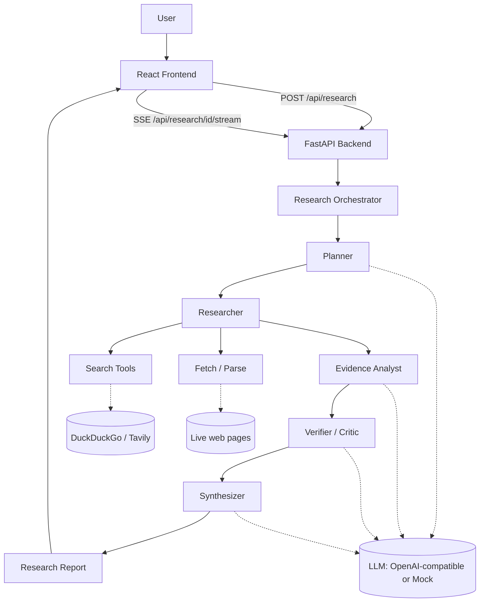

# AI Research Agent

A bounded, citation-grounded multi-source research agent. Give it a question;
it plans subquestions, searches the live web, retrieves and parses sources,
extracts evidence, verifies it for conflicts and unsupported claims, and
synthesizes a structured report — every claim traceable back to a real,
retrieved source.

> Built as project #1 of a five-project AI/GenAI engineering portfolio.

## Overview

Ask something like *"Compare current approaches for reducing hallucinations
in large language models"* and the system runs a fixed, explainable pipeline
— not an open-ended agent loop — to produce a report with an executive
summary, key findings, evidence, explicitly surfaced conflicts, uncertainty,
and numbered citations to the sources actually retrieved.

## Problem

Most "AI research" demos are a single LLM call dressed up with a nice UI: the
model free-associates an answer and citations that may or may not exist. That
is not useful for real research, and it is the exact failure mode ("looks
authoritative, isn't grounded") this project is built to avoid. The
interesting engineering problems are: bounding an agentic workflow so it's
predictable and cheap, keeping every claim traceable to a real source,
surfacing disagreement between sources instead of averaging it away, and
being honest about when there isn't enough evidence to answer at all.

## Why I built it

To demonstrate, in one coherent system, the parts of applied LLM engineering
that don't show up in a wrapper-around-an-API demo: structured tool-calling
pipelines, retrieval and source evaluation, citation grounding, conflict
detection, cost-aware prompting, and a reproducible evaluation harness —
the actual job of building production LLM systems, not just prompting one.

## Features

- Bounded 5-stage pipeline: **Plan → Search → Analyze → Verify → Synthesize**
- Real web search (free DuckDuckGo scraping by default, or Tavily with an API
  key) + real page fetching and content extraction
- Deterministic, explainable source-quality heuristic (no extra LLM call)
- Deterministic relevance pre-filtering *before* the expensive evidence-
  extraction LLM call
- Conflict detection between disagreeing sources, surfaced explicitly rather
  than silently merged
- Every citation marker is assigned in code from an actually-retrieved
  source — the model cannot introduce a source that wasn't retrieved
  - Progress streamed live to the UI via Server-Sent Events (Planning →
  Searching → Analyzing → Verifying → Synthesizing)
- Runs fully offline with zero API keys (mock LLM + mock search) for
  demos/CI, or with real search only (free) for a genuinely retrieval-backed
  run at zero LLM cost
- Usage/cost tracking on every run: searches, sources, LLM calls, tokens,
  estimated cost, latency
- A small, honest local evaluation harness (see [Evaluation](#evaluation))

## Demo instructions

```bash
# 1. Backend (mock LLM + free DuckDuckGo search — no keys required)
cd backend
python -m venv .venv && .venv/Scripts/activate   # or source .venv/bin/activate
pip install -r requirements.txt
uvicorn app.main:app --reload --port 8000

# 2. Frontend
cd frontend
npm install
npm run dev
```

Open http://localhost:5173, enter a research question, and watch it run. With
no `OPENAI_API_KEY` set, search/fetch are real but the synthesized text is a
clearly-labeled mock placeholder — set `OPENAI_API_KEY` in `backend/.env` for
real synthesis (see [Configuration](#configuration)).

## Architecture



Each stage is a plain async function with explicit Pydantic input/output
types (`app/models/schemas.py`) — state passed between stages is structured
data, not free-form text, and there is no recursive agent loop: the pipeline
always runs Plan → Search → Analyze → Verify → Synthesize exactly once, with
hard caps on subquestions, queries, sources, and concurrent requests.

## How the agent works

1. **Planner** (`app/agent/planner.py`) — one LLM call decomposes the
   question into up to 2-4 subquestions (by depth) and matching search
   queries, deduplicated case-insensitively.
2. **Researcher** (`app/agent/researcher.py`) — pure tool-calling, no LLM:
   runs each query against the search provider, dedupes by URL, caps sources
   per domain (diversity), fetches pages concurrently (bounded semaphore,
   timeouts + retries), and extracts main-content text via BeautifulSoup.
3. **Evidence Analyst** (`app/agent/evidence.py`) — deterministically ranks
   fetched sources by lexical relevance to their subquestion, keeps only the
   top N, then makes one bounded LLM call *per kept source* (not per
   fetched source) to extract at most 3 claims, each with a verbatim quote.
4. **Verifier** (`app/agent/verifier.py`) — drops evidence from sources below
   a quality floor deterministically, then makes a **single batched** LLM
   call over all remaining claims to flag cross-source conflicts and
   unsupported claims (not one call per claim).
5. **Synthesizer** (`app/agent/synthesizer.py`) — assigns citation markers in
   code (never left to the model), builds the deterministic Evidence section
   directly from verified claims, and makes one final LLM call — grounded
   only in surviving evidence — for the narrative sections. If no evidence
   survives verification, it returns an explicit "insufficient evidence"
   report instead of asking the model to fill the gap.

## Retrieval / citation approach

- Sources carry full provenance: title, URL, domain, source type, retrieval
  timestamp, and the query that surfaced them.
- Citation markers (`[1]`, `[2]`, …) are assigned by the synthesizer in code,
  in order of first evidence use — the LLM is told which marker maps to
  which evidence and asked to reuse it, never to invent one. Sources that
  never produced surviving evidence never appear in the final report.
- The frontend renders `[n]` markers as jump links to the actual source
  card, so every claim is one click from its source.

## Source quality & conflicts

`app/services/quality.py` scores each source 0–1 from its domain (academic
`.edu`/arXiv/etc. and government score highest, blogs/Medium lowest) and a
mild recency signal — deterministic and explainable, not a claim of
objective truth. `app/agent/verifier.py` explicitly surfaces disagreements
between sources as a distinct "Conflicting Evidence" report section instead
of silently merging contradictory claims into one narrative.

## Tech stack

**Backend:** Python, FastAPI, Pydantic v2, httpx, BeautifulSoup, SQLite
(aiosqlite), Server-Sent Events (sse-starlette). **AI:** OpenAI-compatible
API via the `openai` SDK (works with any compatible endpoint), structured
JSON outputs, with a deterministic mock provider for offline runs.
**Frontend:** React 19, TypeScript, Vite. **Testing:** pytest. **Infra:**
Docker Compose, GitHub Actions CI.

## Cost optimization

This was a first-class design constraint, not an afterthought:

- **Query dedup** — planner-generated search queries are deduplicated
  case-insensitively before any search runs.
- **Source dedup + diversity cap** — sources deduplicated by URL, capped per
  domain, capped in total (`MAX_SOURCES_TOTAL`) before any fetch happens.
- **Relevance filtering before the expensive step** — a cheap, deterministic
  lexical-overlap score ranks fetched sources; only the top
  `MAX_SOURCES_FOR_EVIDENCE` get an LLM evidence-extraction call at all.
- **One batched verifier call**, not one call per claim.
- **Context trimming** — only `MAX_EVIDENCE_CHARS_PER_SOURCE` characters of
  a page (not the whole page) go into the evidence-extraction prompt.
- **Process-lifetime caching** (`app/services/cache.py`) — identical search
  queries and page fetches within the TTL window are never repeated.
- **Structured JSON outputs** everywhere — no free-form chat back-and-forth.
- **Full usage tracking** on every run (searches, sources, LLM calls,
  tokens, estimated cost, duration) surfaced in the UI, so cost is visible,
  not hidden.
- **Offline mock mode** — the entire pipeline runs with zero LLM cost and
  zero API keys, so development, tests, and CI never spend money.

## Evaluation

See [`evaluation/README.md`](evaluation/README.md) for full methodology and
honest limitations. Run it with `python evaluation/run_eval.py` (real search,
mock LLM — free) or `--live` for a real LLM.

### Results (8-question dataset, real DuckDuckGo search, mock LLM)

| Metric | Value |
|---|---|
| Retrieval relevance (avg) | 0.523 |
| Source diversity (avg) | 0.863 |
| Report completeness (avg) | 1.0 |
| Insufficient-evidence rate | 0.0 (every question found usable sources) |
| Avg latency | ~16.0s |
| Total LLM calls (8 questions) | 82 |

Citation coverage/validity/grounding are not meaningful in mock-LLM mode (the
mock model emits fixed placeholder text) — run with `--live` and a real
`OPENAI_API_KEY` to measure those. Full per-question output is committed at
[`evaluation/results/latest_results.json`](evaluation/results/latest_results.json).

## Limitations

- Content extraction is a lightweight BeautifulSoup heuristic, not a full
  readability/boilerplate-removal pipeline — it occasionally mis-extracts a
  page's title or grabs navigation text on unusually-structured pages.
- The free DuckDuckGo search path scrapes an HTML endpoint rather than using
  a paid API, so it can be rate-limited or change without notice; Tavily is
  supported as a drop-in, more reliable alternative.
- Relevance scoring is lexical (word overlap), not semantic — a source that
  is relevant but uses entirely different vocabulary from the subquestion
  can be under-scored.
- No vector database / embedding-based retrieval is used — for the scope and
  data volume of a single research run (a dozen sources), a deterministic
  lexical filter is simpler, cheaper, and sufficiently effective; this would
  be revisited if the design retrieved from a large persistent corpus.
- The pipeline runs once per question; it does not re-plan or loop back if
  early evidence looks thin (by design, to keep cost/latency bounded) — it
  instead reports "insufficient evidence" honestly.
- Evaluation dataset is 8 questions — enough to sanity-check behavior, not a
  statistically rigorous benchmark.

## Future improvements

- Optional embedding-based re-ranking as a second relevance signal alongside
  the lexical heuristic.
- Pluggable search providers beyond Tavily/DuckDuckGo (e.g. Bing, SearXNG).
- Persisted per-source page cache (currently process-lifetime only) to avoid
  re-fetching across server restarts.
- A lightweight re-planning step when verification yields very sparse
  evidence, still bounded to a single extra iteration.

## Installation

Prerequisites: Python 3.11+, Node 20+.

```bash
git clone <this-repo>
cd ai-research-agent
cp .env.example backend/.env       # optional: add OPENAI_API_KEY / TAVILY_API_KEY
cp frontend/.env.example frontend/.env
```

## Configuration

All settings are environment variables, loaded from `backend/.env` (see
[`.env.example`](.env.example) for the full list with defaults). Everything
is optional — the system runs fully offline with no configuration at all.

Key variables:

| Variable | Default | Effect |
|---|---|---|
| `OPENAI_API_KEY` | *(empty)* | Blank → mock LLM (offline, zero cost) |
| `OPENAI_BASE_URL` | OpenAI's API | Point at any OpenAI-compatible endpoint |
| `SEARCH_PROVIDER` | `auto` | `auto` \| `tavily` \| `duckduckgo` \| `mock` |
| `TAVILY_API_KEY` | *(empty)* | Enables Tavily when `SEARCH_PROVIDER=auto`/`tavily` |
| `MAX_SOURCES_TOTAL` | 12 | Hard cap on sources fetched per run |
| `MAX_SOURCES_FOR_EVIDENCE` | 8 | Cap on sources that get an LLM evidence call |

## Running locally

```bash
# Backend
cd backend
python -m venv .venv
.venv/Scripts/activate      # Windows; use `source .venv/bin/activate` on macOS/Linux
pip install -r requirements.txt
uvicorn app.main:app --reload --port 8000

# Frontend (separate terminal)
cd frontend
npm install
npm run dev
```

Or via Docker Compose:

```bash
docker compose up --build
```

## Testing

```bash
cd backend
pip install -r requirements.txt pytest
pytest -q
```

23 tests covering: source-quality heuristics, relevance scoring, the TTL
cache, the full offline pipeline (Planner → Synthesizer with mock providers,
including the citation-grounding invariant), and an API-level smoke test
that exercises the real FastAPI app end-to-end.

## Evaluation

```bash
python evaluation/run_eval.py            # real search, mock LLM (free)
python evaluation/run_eval.py --live      # real search + real LLM
```

## Project structure

```text
ai-research-agent/
├── backend/
│   ├── app/
│   │   ├── agent/          # planner, researcher, evidence, verifier, synthesizer, orchestrator
│   │   ├── api/            # FastAPI routes
│   │   ├── llm/            # LLM provider abstraction + prompts
│   │   ├── models/         # Pydantic schemas (shared state contracts)
│   │   ├── services/       # cache, quality heuristic, relevance, jobs, storage
│   │   ├── tools/           # search + fetch tools
│   │   ├── config.py
│   │   └── main.py
│   ├── requirements.txt
│   └── Dockerfile
├── frontend/                # React + TypeScript + Vite
│   └── src/
│       ├── components/
│       ├── hooks/
│       └── api/
├── tests/                   # pytest suite (backend + API smoke test)
├── evaluation/               # dataset, eval harness, results, methodology
├── docs/
├── scripts/                  # dev convenience scripts
├── docker-compose.yml
├── .env.example
└── README.md
```

## License

MIT — see [LICENSE](LICENSE).
