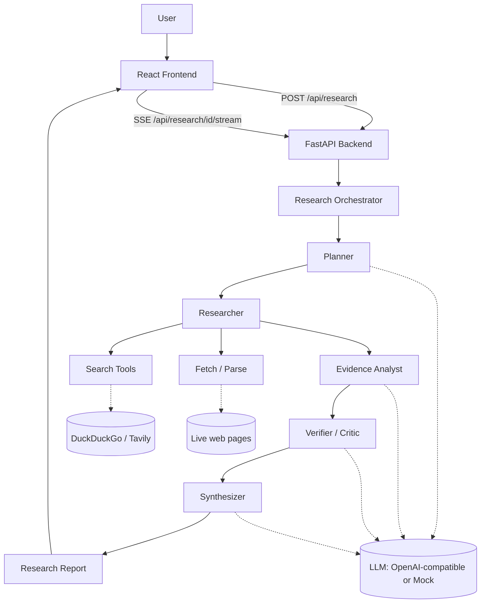

# AI Research Agent

A bounded, citation-grounded multi-source research agent. Give it a question;
it plans subquestions, searches the live web, retrieves and parses sources,
extracts evidence, verifies it for conflicts and unsupported claims, and
synthesizes a structured report — every claim traceable back to a real,
retrieved source.

> Built as project #1 of a five-project AI/GenAI engineering portfolio.

## Overview

Ask something like *"Compare current approaches for reducing hallucinations
in large language models"* and the system runs a fixed, explainable pipeline
— not an open-ended agent loop — to produce a report with an executive
summary, key findings, evidence, explicitly surfaced conflicts, uncertainty,
and numbered citations to the sources actually retrieved.

## Problem

Most "AI research" demos are a single LLM call dressed up with a nice UI: the
model free-associates an answer and citations that may or may not exist. That
is not useful for real research, and it is the exact failure mode ("looks
authoritative, isn't grounded") this project is built to avoid. The
interesting engineering problems are: bounding an agentic workflow so it's
predictable and cheap, keeping every claim traceable to a real source,
surfacing disagreement between sources instead of averaging it away, and
being honest about when there isn't enough evidence to answer at all.

## Why I built it

To demonstrate, in one coherent system, the parts of applied LLM engineering
that don't show up in a wrapper-around-an-API demo: structured tool-calling
pipelines, retrieval and source evaluation, citation grounding, conflict
detection, cost-aware prompting, and a reproducible evaluation harness —
the actual job of building production LLM systems, not just prompting one.

## Features

- Bounded 5-stage pipeline: **Plan → Search → Analyze → Verify → Synthesize**
- Real web search (free DuckDuckGo scraping by default, or Tavily with an API
  key) + real page fetching and content extraction
- Deterministic, explainable source-quality heuristic (no extra LLM call)
- Deterministic relevance pre-filtering *before* the expensive evidence-
  extraction LLM call
- Conflict detection between disagreeing sources, surfaced explicitly rather
  than silently merged
- Every citation marker is assigned in code from an actually-retrieved
  source, then **re-validated after synthesis**: any `[n]` marker the model
  writes that wasn't actually assigned is stripped deterministically, never
  trusted (`app/services/citation_validator.py`)
- Every extracted quote is **deterministically checked** against the actual
  retrieved page text (normalized substring match, not an LLM's say-so)
  before being treated as verified (`app/services/quote_verification.py`)
- Evidence-extraction context is selected by **paragraph-level relevance
  scoring**, not a naive character prefix — the paragraphs most related to
  the subquestion are kept, wherever they fall on the page
  (`app/services/context_selection.py`)
- Subquestion ↔ search-query mapping is an **explicit data relationship**
  (`Subquestion → SearchQuery[]`), not inferred positionally
- Conflict detection between disagreeing sources, surfaced explicitly rather
  than silently merged
- Progress streamed live to the UI via Server-Sent Events (Planning →
  Searching → Analyzing → Verifying → Synthesizing)
- Runs fully offline with zero API keys (mock LLM + mock search) for
  demos/CI, or with real search only (free) for a genuinely retrieval-backed
  run at zero LLM cost
- Usage/cost tracking on every run: searches, cache hits, sources, LLM
  calls, tokens, estimated cost, latency
- A small, honest local evaluation harness over 22 questions across 6
  categories (see [Evaluation](#evaluation))

## Demo instructions

```bash
# 1. Backend (mock LLM + free DuckDuckGo search — no keys required)
cd backend
python -m venv .venv && .venv/Scripts/activate   # or source .venv/bin/activate
pip install -r requirements.txt
uvicorn app.main:app --reload --port 8000

# 2. Frontend
cd frontend
npm install
npm run dev
```

Open http://localhost:5173, enter a research question, and watch it run. With
no `OPENAI_API_KEY` set, search/fetch are real but the synthesized text is a
clearly-labeled mock placeholder — set `OPENAI_API_KEY` in `backend/.env` for
real synthesis (see [Configuration](#configuration)).

## Architecture



Each stage is a plain async function with explicit Pydantic input/output
types (`app/models/schemas.py`) — state passed between stages is structured
data, not free-form text, and there is no recursive agent loop: the pipeline
always runs Plan → Search → Analyze → Verify → Synthesize exactly once, with
hard caps on subquestions, queries, sources, and concurrent requests.

## How the agent works

1. **Planner** (`app/agent/planner.py`) — one LLM call decomposes the
   question into up to 2-4 subquestions (by depth), each carrying its own
   `search_queries` list (`SubquestionPlan` in `app/models/schemas.py`) —
   an explicit relationship, not two parallel lists matched up positionally.
2. **Researcher** (`app/agent/researcher.py`) — pure tool-calling, no LLM:
   runs each query against the search provider, dedupes by URL, caps sources
   per domain (diversity), fetches pages concurrently (bounded semaphore,
   timeouts + retries), and extracts main-content text via BeautifulSoup.
   Tracks cache hits/misses and per-query search success for usage stats.
3. **Evidence Analyst** (`app/agent/evidence.py`) — deterministically ranks
   fetched sources by lexical relevance to their subquestion, keeps only the
   top N, then makes one bounded LLM call *per kept source* (not per
   fetched source) to extract at most 3 claims, each with a verbatim quote.
   The context sent to the model is selected by paragraph-relevance scoring
   (`app/services/context_selection.py`), and every returned quote is
   immediately checked against the source's full retrieved text
   (`app/services/quote_verification.py`) — `Evidence.quote_verified` is set
   by that check, never by the model's own claim.
4. **Verifier** (`app/agent/verifier.py`) — drops evidence from sources below
   a quality floor deterministically, then makes a **single batched** LLM
   call over all remaining claims to flag cross-source conflicts and
   unsupported claims (not one call per claim).
5. **Synthesizer** (`app/agent/synthesizer.py`) — assigns citation markers in
   code (never left to the model), builds the deterministic Evidence section
   directly from verified claims, and makes one final LLM call — grounded
   only in surviving evidence — for the narrative sections. The model's
   output is then swept for `[n]` markers by
   `app/services/citation_validator.py`: any marker not in the assigned set
   is stripped, and the resulting counts are recorded on
   `report.quality_stats` (not just asserted in prose). If no evidence
   survives verification, it returns an explicit "insufficient evidence"
   report instead of asking the model to fill the gap.

## Citation grounding

Citation IDs are **assigned and validated deterministically against
retrieved sources** — never trusted to the LLM:

1. The synthesizer assigns `[1]`, `[2]`, … in code, in order of first
   evidence use, only to sources that actually produced surviving evidence.
   The model is told which marker maps to which evidence and asked to reuse
   it — it is never asked to invent one.
2. **After** synthesis, every free-text field the model wrote (executive
   summary, key findings, analysis, conclusion) is scanned for `[n]`
   markers by `app/services/citation_validator.py`. Any marker that doesn't
   match an assigned source is removed from the text (not replaced with a
   fabricated stand-in), and the counts (`markers_found`, `markers_valid`,
   `markers_invalid_removed`) are recorded on
   `report.quality_stats`.
3. The frontend renders `[n]` markers as jump links to the actual source
   card, so every surviving claim is one click from its source.

**Citation validation guarantees that every surviving citation marker maps to
a source actually retrieved by the system; it does not guarantee that every
cited claim is factually correct or fully supported by that source.** That
narrower guarantee — whether a claim's evidence is actually backed by the
source text — is what [evidence verification](#evidence-verification) and
the verifier's checks are for.

## Evidence verification

Each evidence claim carries a `quote` the model was asked to copy verbatim
from the source. That quote is deterministically checked against the
source's actual retrieved content
(`app/services/quote_verification.py::verify_quote`) — substring matching
after normalizing whitespace, smart quotes/dashes, and case, so harmless
formatting differences don't cause false failures, but a genuine paraphrase
correctly fails. The result is stored on `Evidence.quote_verified`; it is
never rewritten into a "verified" quote if the check fails. An evidence item
that supplied a quote but failed this check is dropped by the verifier
(`app/agent/verifier.py`) before synthesis — it is never presented as
verified evidence downstream, regardless of what the LLM verifier pass
says. Quote-less evidence (no quote attempted) is unaffected by this check.
Aggregate `quotes_attempted` / `quotes_verified` counts land on
`report.quality_stats`.

## Retrieval & content selection

- Sources carry full provenance: title, URL, domain, source type, retrieval
  timestamp, and the query (and subquestion — an explicit, non-positional
  mapping) that surfaced them.
- Relevance and content selection are both **lexical** (word-overlap
  scoring, `app/services/relevance.py`), not semantic/embedding-based — see
  [Limitations](#limitations). This is a deliberate scope decision, not an
  oversight.
- Instead of sending a naive character prefix of a page to the
  evidence-extraction LLM call, `app/services/context_selection.py` splits
  extracted text into paragraphs, scores each against the subquestion with
  the same lexical relevance function used for source ranking, and keeps
  the highest-scoring paragraphs — in original document order — up to the
  character budget. This both improves what evidence gets extracted and
  avoids spending tokens on boilerplate that happened to appear first.

## Source quality & conflicts

`app/services/quality.py` scores each source 0–1 from its domain (academic
`.edu`/arXiv/etc. and government score highest, blogs/Medium lowest) and a
mild recency signal — deterministic and explainable, not a claim of
objective truth. `app/agent/verifier.py` explicitly surfaces disagreements
between sources as a distinct "Conflicting Evidence" report section instead
of silently merging contradictory claims into one narrative.

## Tech stack

**Backend:** Python, FastAPI, Pydantic v2, httpx, BeautifulSoup, SQLite
(aiosqlite), Server-Sent Events (sse-starlette). **AI:** OpenAI-compatible
API via the `openai` SDK (works with any compatible endpoint), structured
JSON outputs, with a deterministic mock provider for offline runs.
**Frontend:** React 19, TypeScript, Vite. **Testing:** pytest. **Infra:**
Docker Compose, GitHub Actions CI.

## Cost optimization

This was a first-class design constraint, not an afterthought:

- **Query dedup** — planner-generated search queries are deduplicated
  case-insensitively before any search runs.
- **Source dedup + diversity cap** — sources deduplicated by URL, capped per
  domain, capped in total (`MAX_SOURCES_TOTAL`) before any fetch happens.
- **Relevance filtering before the expensive step** — a cheap, deterministic
  lexical-overlap score ranks fetched sources; only the top
  `MAX_SOURCES_FOR_EVIDENCE` get an LLM evidence-extraction call at all.
- **One batched verifier call**, not one call per claim.
- **Context trimming with relevance selection** — only
  `MAX_EVIDENCE_CHARS_PER_SOURCE` characters go into the evidence-extraction
  prompt, and those characters are the highest-relevance paragraphs (see
  [Retrieval & content selection](#retrieval--content-selection)), not
  whatever happened to come first on the page.
- **Process-lifetime caching** (`app/services/cache.py`) — identical search
  queries and page fetches within the TTL window are never repeated; actual
  hit/miss counts are tracked per run (`usage.cache_hits`), not just assumed.
- **Structured JSON outputs** everywhere — no free-form chat back-and-forth.
- **Full usage tracking** on every run (searches, sources, LLM calls,
  tokens, estimated cost, duration) surfaced in the UI, so cost is visible,
  not hidden.
- **Offline mock mode** — the entire pipeline runs with zero LLM cost and
  zero API keys, so development, tests, and CI never spend money.

## Evaluation

See [`evaluation/README.md`](evaluation/README.md) for full methodology and
honest limitations. Run it with `python evaluation/run_eval.py` (real search,
mock LLM — free) or `--live` for a real LLM. Every run writes
`evaluation/results/latest_results.json` (timestamped, mode-labeled,
regenerated on demand — not committed, since it's a reproducible artifact,
not a build output).

### Illustrative results (22-question dataset, real DuckDuckGo search, mock LLM)

Numbers below are from one local run — reproduce with the command above,
your own numbers may vary slightly (live web search, not a fixed corpus).

| Metric | Value | Meaningful in mock mode? |
|---|---|---|
| Retrieval relevance (avg) | 0.49 | ✅ yes — real sources, lexical scoring |
| Source diversity (avg) | 0.87 | ✅ yes |
| Report completeness (avg) | 1.0 | ✅ yes |
| Search success rate (avg) | 1.0 | ✅ yes |
| Evidence retention (avg) | 1.0 | ✅ yes |
| Insufficient-evidence rate | 0.09 (2/22 questions) | ✅ yes |
| Citation coverage / validity, quote validity | 0.0 / n/a / n/a | ❌ **no** — mock LLM emits fixed placeholder text with no citations or quotes by design |
| Avg latency | ~9.6s | partly — dominated by real search/fetch, not LLM |
| Total LLM calls (22 questions) | 191 | — |

Citation validity, quote validity, and citation coverage only measure
something real in **`--live`** mode with a real `OPENAI_API_KEY` — the
numbers above are reported honestly as not applicable in mock mode rather
than presented as if they demonstrated real model quality.

## Limitations

- Content extraction is a lightweight BeautifulSoup heuristic, not a full
  readability/boilerplate-removal pipeline — it occasionally mis-extracts a
  page's title or grabs navigation text on unusually-structured pages.
- The free DuckDuckGo search path scrapes an HTML endpoint rather than using
  a paid API, so it can be rate-limited or change without notice; Tavily is
  supported as a drop-in, more reliable alternative.
- Relevance scoring is lexical (word overlap), not semantic — a source that
  is relevant but uses entirely different vocabulary from the subquestion
  can be under-scored.
- No vector database / embedding-based retrieval is used — for the scope and
  data volume of a single research run (a dozen sources), a deterministic
  lexical filter is simpler, cheaper, and sufficiently effective; this would
  be revisited if the design retrieved from a large persistent corpus.
- The pipeline runs once per question; it does not re-plan or loop back if
  early evidence looks thin (by design, to keep cost/latency bounded) — it
  instead reports "insufficient evidence" honestly.
- Quote verification is a literal (normalized substring) check, not semantic
  similarity — a quote that is accurate but reworded by the model will
  correctly fail verification even though the underlying claim may still be
  true; this is a deliberate precision-over-recall tradeoff for an "is this
  provably real" guarantee.
- Citation validation guarantees every surviving `[n]` marker points at an
  actually-retrieved source; it does not verify that the claim next to the
  marker is itself accurate — that's what evidence/quote verification and
  the verifier's LLM pass are for, each catching a different failure mode.
- Evaluation dataset is ~22 questions across 6 categories — enough to
  sanity-check behavior broadly, not a statistically rigorous benchmark.

## Future improvements

- Optional embedding-based re-ranking as a second relevance signal alongside
  the lexical heuristic.
- Pluggable search providers beyond Tavily/DuckDuckGo (e.g. Bing, SearXNG).
- Persisted per-source page cache (currently process-lifetime only) to avoid
  re-fetching across server restarts.
- A lightweight re-planning step when verification yields very sparse
  evidence, still bounded to a single extra iteration.

## Installation

Prerequisites: Python 3.11+, Node 20+.

```bash
git clone <this-repo>
cd ai-research-agent
cp .env.example backend/.env       # optional: add OPENAI_API_KEY / TAVILY_API_KEY
cp frontend/.env.example frontend/.env
```

## Configuration

All settings are environment variables, loaded from `backend/.env` (see
[`.env.example`](.env.example) for the full list with defaults). Everything
is optional — the system runs fully offline with no configuration at all.

Key variables:

| Variable | Default | Effect |
|---|---|---|
| `OPENAI_API_KEY` | *(empty)* | Blank → mock LLM (offline, zero cost) |
| `OPENAI_BASE_URL` | OpenAI's API | Point at any OpenAI-compatible endpoint |
| `SEARCH_PROVIDER` | `auto` | `auto` \| `tavily` \| `duckduckgo` \| `mock` |
| `TAVILY_API_KEY` | *(empty)* | Enables Tavily when `SEARCH_PROVIDER=auto`/`tavily` |
| `MAX_SOURCES_TOTAL` | 12 | Hard cap on sources fetched per run |
| `MAX_SOURCES_FOR_EVIDENCE` | 8 | Cap on sources that get an LLM evidence call |

## Running locally

```bash
# Backend
cd backend
python -m venv .venv
.venv/Scripts/activate      # Windows; use `source .venv/bin/activate` on macOS/Linux
pip install -r requirements.txt
uvicorn app.main:app --reload --port 8000

# Frontend (separate terminal)
cd frontend
npm install
npm run dev
```

Or via Docker Compose:

```bash
docker compose up --build
```

## Testing

```bash
cd backend
pip install -r requirements.txt pytest
pytest -q
```

54 tests covering: source-quality heuristics, relevance scoring, the TTL
cache and cache-hit tracking, citation-marker sanitization (valid/invalid/
missing/multiple), deterministic quote verification (exact/whitespace/
missing/malformed), paragraph-relevance context selection, explicit
subquestion↔query mapping (including uneven query counts per subquestion),
the full offline pipeline (Planner → Synthesizer with mock providers,
including the citation-grounding invariant), and an API-level smoke test
that exercises the real FastAPI app end-to-end.

## Evaluation

```bash
python evaluation/run_eval.py            # real search, mock LLM (free)
python evaluation/run_eval.py --live      # real search + real LLM
```

## Project structure

```text
ai-research-agent/
├── backend/
│   ├── app/
│   │   ├── agent/          # planner, researcher, evidence, verifier, synthesizer, orchestrator
│   │   ├── api/            # FastAPI routes
│   │   ├── llm/            # LLM provider abstraction + prompts
│   │   ├── models/         # Pydantic schemas (shared state contracts)
│   │   ├── services/       # cache, quality, relevance, context selection,
│   │   │                    # citation validation, quote verification, jobs, storage
│   │   ├── tools/           # search + fetch tools
│   │   ├── config.py
│   │   └── main.py
│   ├── requirements.txt
│   └── Dockerfile
├── frontend/                # React + TypeScript + Vite
│   └── src/
│       ├── components/
│       ├── hooks/
│       └── api/
├── tests/                   # pytest suite (backend + API smoke test)
├── evaluation/               # dataset, eval harness, results, methodology
├── docs/
├── scripts/                  # dev convenience scripts
├── docker-compose.yml
├── .env.example
└── README.md
```

## License

MIT — see [LICENSE](LICENSE).
